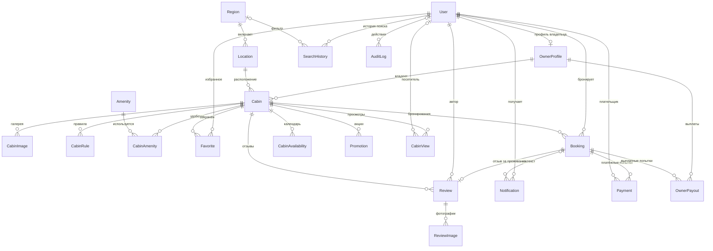

# База данных A-FRAME KG

Схема построена по [`ТЗ.md`](../ТЗ.md) и [`Схема БД.md`](../Схема%20БД.md). Все 21 таблица из описания перенесены в [`schema.prisma`](schema.prisma); имена таблиц и колонок в PostgreSQL сохранены через `@@map` и `@map`, в Prisma используются PascalCase для моделей и camelCase для полей.

## Анализ архитектуры

21 экран из ТЗ описывает навигацию приложения. Экраны каталога, поиска, галереи и кабинета работают с общими сущностями; отдельная таблица для каждого экрана не нужна. Исходный проект уже использует Next.js App Router, хотя ТЗ описывает React Router. Схема данных не зависит от этого различия.

Основной сценарий состоит из каталога домиков, избранного, бронирования и отзывов. Описание БД дополнительно содержит платежи, выплаты, уведомления и аудит — эти сущности сохранены для расширения проекта. Реальная оплата в учебном ТЗ не требуется.

| Область | Модели |
| --- | --- |
| Аккаунты и владельцы | `User`, `OwnerProfile` |
| Каталог и география | `Region`, `Location`, `Cabin`, `CabinImage`, `Amenity`, `CabinAmenity`, `CabinRule` |
| Проживание | `Favorite`, `Booking`, `CabinAvailability`, `Review`, `ReviewImage` |
| Дополнительные функции | `Notification`, `SearchHistory`, `Promotion`, `Payment`, `CabinView`, `OwnerPayout`, `AuditLog` |



## Принятые решения

- **PostgreSQL + Prisma ORM 7.10.0.** PostgreSQL поддерживает необходимые точные денежные типы, перечисления, JSONB и ограничения пересечения дат. Версии CLI и клиента совпадают и закреплены. URL подключения находится в `prisma.config.ts`.
- **Типы.** `BIGINT` → `BigInt`, справочники `INT` → `Int`, деньги → `Decimal(10,2)`, координаты → `Decimal(10,7)`, даты проживания → `DateTime @db.Date`. Временные отметки используют `Timestamptz(3)`, чтобы сохранять моменты времени независимо от часового пояса. Пользовательский часовой пояс для отображения — `Asia/Bishkek`.
- **Владелец.** `cabins.owner_id` и `owner_payouts.owner_id` ссылаются на `owner_profiles.id`. Один аккаунт имеет максимум один профиль владельца. Роль `ADMIN` сохранена из описания БД; роли `USER` и `OWNER` соответствуют ТЗ. Владелец может также бронировать жильё.
- **Уникальность.** Нельзя повторно добавить тот же домик в избранное или создать две календарные записи на один день. Один отзыв соответствует одному бронированию; составной FK проверяет, что его автор и домик совпадают с бронированием. Платёж также связан с пользователем своего бронирования.
- **Необязательные данные.** Фамилия, аватар, реквизиты бизнеса, город/село, координаты, подпись фотографии, индивидуальная цена дня и параметры поиска могут отсутствовать. Email гостя необязателен, поскольку форма бронирования из ТЗ требует имя и телефон. Просмотры могут быть анонимными, аудит — системным, уведомление — без бронирования. `transactionId` и `paidAt` не заполняются до обработки платежа.
- **Снимок бронирования.** Контакты гостя, цена, скидка, комиссия и итог хранятся в `Booking` отдельно от профиля и текущей цены домика. Последующее редактирование профиля или объявления не меняет эти данные. Их неизменность после подтверждения должен обеспечивать сервис.
- **Календарь.** `CabinAvailability` хранит исключения и дневные цены. При отсутствии записи применяется базовая цена домика; занятость всегда проверяется по бронированиям. `BOOKED` — вспомогательный статус, который сервис синхронизирует с ними.
- **Удаление.** Внешние ключи `Restrict` сохраняют историю бронирований, отзывов, платежей и выплат. Для снятия объявления используется `ARCHIVED`, для аккаунта — `isActive = false`. Фотографии, правила и другие зависимые данные удаляются каскадно при допустимом физическом удалении родителя. Пользователь в просмотрах и аудите при удалении заменяется на `NULL`.

## Ограничения в миграциях

Первая миграция создаёт типы, таблицы, индексы и внешние ключи из Prisma. Вторая добавляет PostgreSQL-проверки, которые нельзя полностью описать обычной схемой Prisma:

- Заезд раньше выезда; количество ночей равно разнице дат; количество гостей положительное.
- Суммы неотрицательны; скидка не превышает стоимость проживания; `totalAmount = subtotal - discountAmount + serviceFee`. `subtotal` не приравнивается к `nights × pricePerNight`, поскольку календарь допускает разные дневные цены.
- Оценка отзыва от 1 до 5; средний рейтинг от 0 до 5; координаты заданы парой и находятся в допустимых пределах.
- Даты и суммы фильтров и акций корректны; процентная скидка не превышает 100.
- Оплаченный или возвращённый платёж содержит дату оплаты; сумма выплаты равна полной сумме за вычетом комиссии.
- Главная фотография у домика максимум одна. Черновик может пока не иметь главной фотографии.
- На бронирование допускается одна выплата в `PENDING` или `PAID`; отменённая попытка допускает повторную выплату. Частичные выплаты потребуют изменения этого правила.
- `EXCLUDE USING GIST` запрещает пересечения периодов одного домика для `PENDING`, `CONFIRMED`, `COMPLETED`, включая одновременные запросы. Период `[checkIn, checkOut)` позволяет заезд следующего гостя в день выезда предыдущего. `CANCELLED` и `REJECTED` освобождают даты.

Последнее правило использует расширение `btree_gist`, устанавливаемое миграцией. Сервер должен предоставлять это расширение, а пользователь миграций — иметь право его установить. SQL-ограничения сохраняются через историю миграций: для развёртывания используется `migrate deploy`, а при изменении схемы — `migrate dev`. `db push` не создаёт полный набор этих ограничений.

Принцип ручного дополнения миграций описан в [документации Prisma ORM 7](https://www.prisma.io/docs/orm/v7/prisma-migrate/workflows/customizing-migrations); семантика диапазонов и `EXCLUDE` — в [документации PostgreSQL](https://www.postgresql.org/docs/current/rangetypes.html#RANGETYPES-CONSTRAINT).

## Правила будущего сервиса

База обеспечивает перечисленные ограничения. Для межтабличных проверок и прав доступа нужны серверные операции:

1. При бронировании проверить, что домик опубликован, число гостей не превышает `maxGuests`, дни не заблокированы, цены и скидка рассчитаны на сервере. Проверку календаря и создание бронирования выполнять в одной транзакции с блокировкой строки домика; изменение календаря должно брать ту же блокировку.
2. Заявка `PENDING` удерживает даты до явной отмены или отклонения. В исходном описании нет `expiresAt`: если нужны временные резервы, добавить срок действия и задачу освобождения дат.
3. Перед отзывом проверить завершённое проживание и пользователя текущей сессии. `rating` и `reviewsCount` пересчитывать по опубликованным отзывам в транзакции при публикации, изменении или скрытии отзыва.
4. Перед выплатой проверить принадлежность забронированного домика владельцу и статус расчётов. Владельца для исторических расчётов нельзя менять без отдельной модели передачи собственности.
5. Проверять переходы статусов платежей, выплат и бронирований, идемпотентность обработчиков оплаты, общую оплаченную сумму и валюту. Базовая валюта проекта — KGS; бронирования и выплаты в текущей модели не содержат отдельных полей валюты. `payments.transaction_id` предполагается уникальным во всём проекте; при нескольких провайдерах нужно отдельное поле провайдера и составная уникальность.
6. Профиль владельца и роль аккаунта изменять согласованно. Проверять право владельца редактировать конкретный объект. Хранить только хеш пароля; нормализовать email в нижний регистр перед записью и поиском, поскольку обычный `@unique` у PostgreSQL чувствителен к регистру.
7. `AuditLog.entityId` — полиморфная ссылка без FK на одну таблицу. Сервис должен записывать корректный тип и ID; старые и новые данные могут отсутствовать.

При ответах API сериализуйте `BigInt` в строки: стандартный `JSON.stringify` его не поддерживает. Денежные вычисления выполняйте с `Prisma.Decimal`, избегая потери точности при преобразовании в JavaScript `number`.

## Запуск

Требуется Node.js версии, совместимой с Prisma 7 (например, установленный Node.js 24), и отдельная база PostgreSQL. Официальные требования: [Prisma ORM 7](https://www.prisma.io/docs/orm/v7/reference/system-requirements).

1. Установите зависимости: `npm install`.
2. Создайте `.env` на основе [`.env.example`](../.env.example), замените `YOUR_USER`, `YOUR_PASSWORD`, имя базы и адрес сервера своими значениями. `.env` исключён из Git.
3. Проверьте схему и сгенерируйте клиент:

   ```powershell
   npm run db:validate
   npm run db:generate
   ```

4. Примените подготовленные миграции к новой базе:

   ```powershell
   npm run db:deploy
   ```

5. Для последующих изменений в локальной разработке:

   ```powershell
   npm run db:migrate -- --name describe_change
   npm run db:generate
   ```

`migrate dev` использует дополнительную shadow database; локальному пользователю нужны права на её создание или отдельная настройка `shadowDatabaseUrl`. `db:deploy` применяет существующие миграции без shadow database. В Prisma 7 генерацию клиента запускайте явно после изменений.

Дополнительные команды: `npm run db:format`, `npm run db:studio`. Проверка схемы и генерация клиента работают без `DATABASE_URL`; команды, подключающиеся к БД, требуют заполненного URL.

Клиент генерируется в `generated/prisma` и исключён из Git и ESLint. Backend и подключение клиента к страницам не входят в создание схемы. При добавлении серверного доступа Prisma 7 требует PostgreSQL-адаптер `@prisma/adapter-pg`; экземпляр клиента создаётся с этим адаптером только на сервере. Подробнее: [Prisma Client 7](https://www.prisma.io/docs/orm/v7/prisma-client/setup-and-configuration/introduction).

## Проверка реализации

`prisma format`, `prisma validate`, `prisma generate`, ESLint и TypeScript прошли успешно. Обе SQL-миграции выполнены в отдельной PostgreSQL 18.3 через PGlite с расширением `btree_gist`: 65 проверок вставки, изменения и удаления подтвердили ограничения дат, сумм, связей, уникальности и сохранения истории. Проверка не обращалась к пользовательской базе; временная база и инструменты удалены. Параллельные подключения и права установки расширения на целевом сервере этой проверкой не проверялись.
